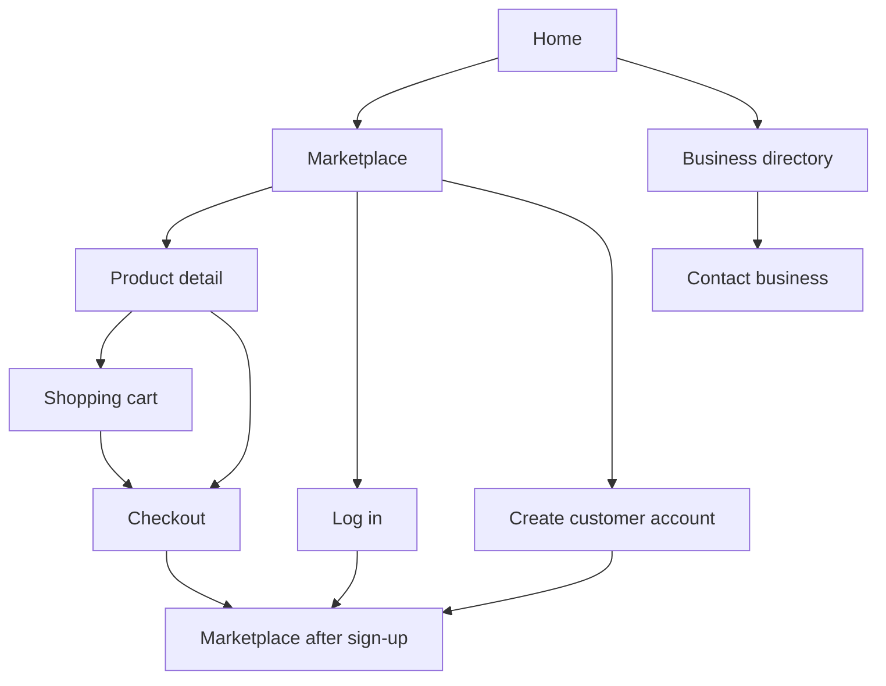
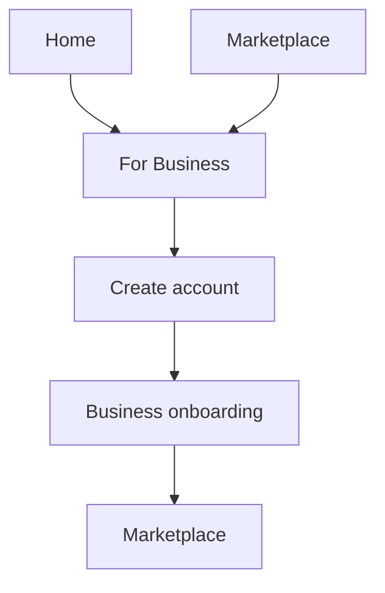

# BizConnect user flow

## Page organization

- `app/public/` — public discovery pages: home, marketplace, businesses, about and contact.
- `app/account/` — customer access pages: login and sign-up.
- `app/business/` — business-owner activation: onboarding.
- `assets/` — shared CSS, JavaScript and images.

## Customer journey

1. Discover the marketplace from `app/public/home.html`.
2. Browse or filter products at `app/public/marketplace.html`.
3. Choose `Buy now` to open `app/account/login.html`.
4. Log in or create a Customer account.
5. Continue to the marketplace.

The imported shopping screens are available at `app/shop/products.html`, `app/shop/product-details.html`, `app/shop/cart.html` and `app/shop/checkout.html`.

## Business-owner journey

1. Choose `For Business` from any main navigation or call to action.
2. Create an account and choose `Business owner`.
3. Complete `app/business/onboarding.html`.
4. Continue to the marketplace after the profile is saved locally.

## Support journey

`Home` -> `About` or `Contact` -> confirmation -> `Home`.

Business profiles are available at `app/business/profile.html`. The profile supports Products, About, Reviews and Policies tabs, product-category filtering, a persisted Follow state, and Message seller routing to Contact. The imported admin overview is available at `app/admin/dashboard.html`.

The current authentication and onboarding demo uses `localStorage`; Supabase integration remains the next backend step documented in `docs/phase2.md`.
